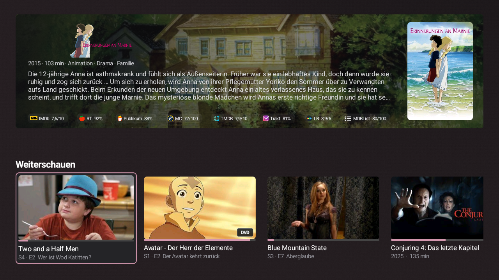
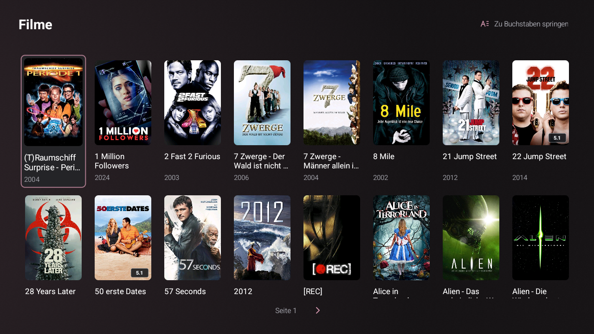
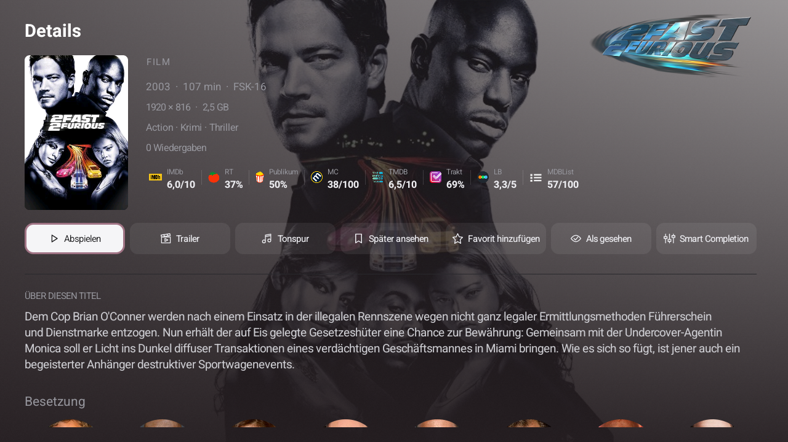
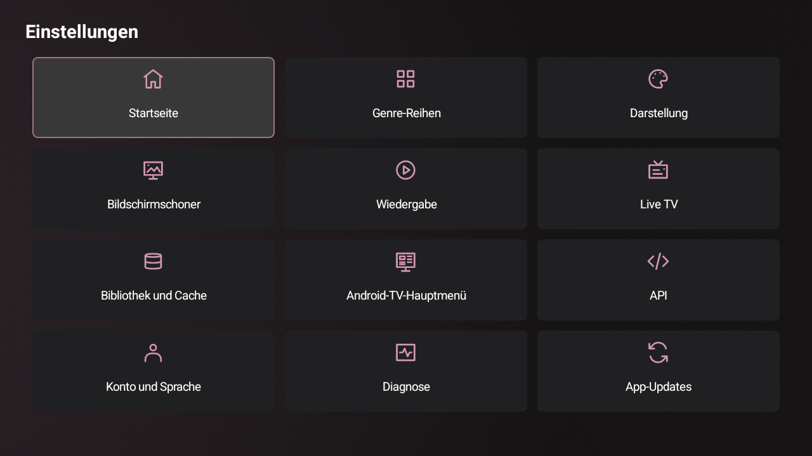
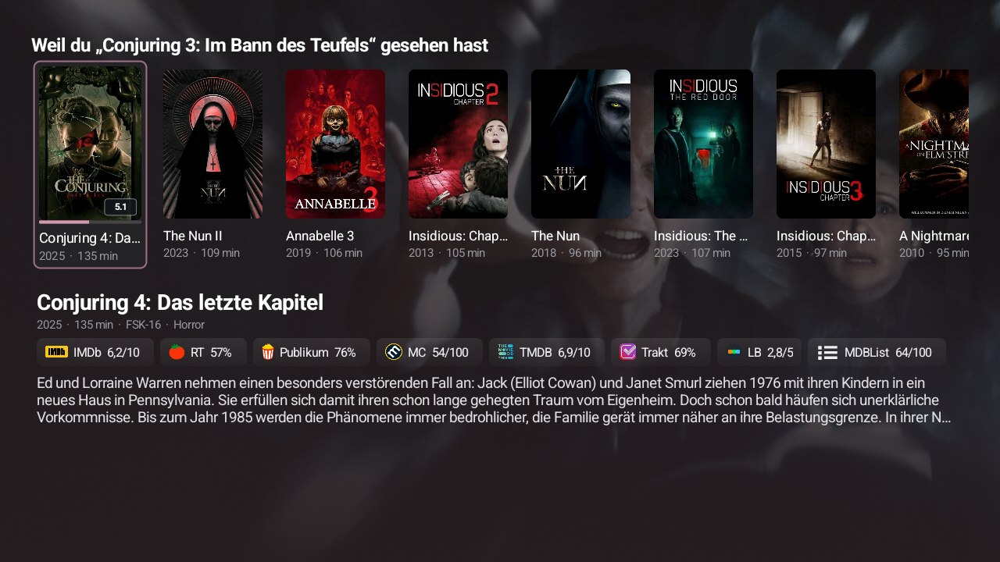
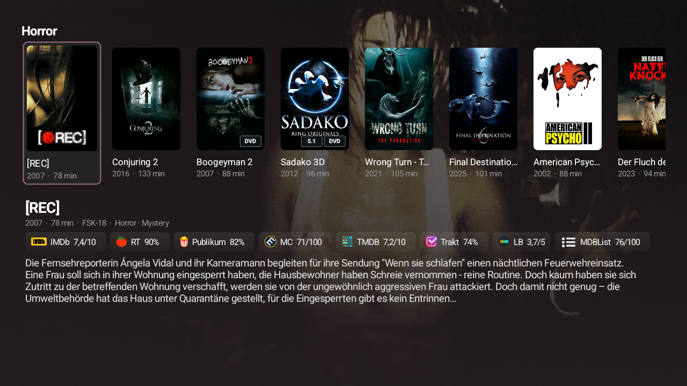
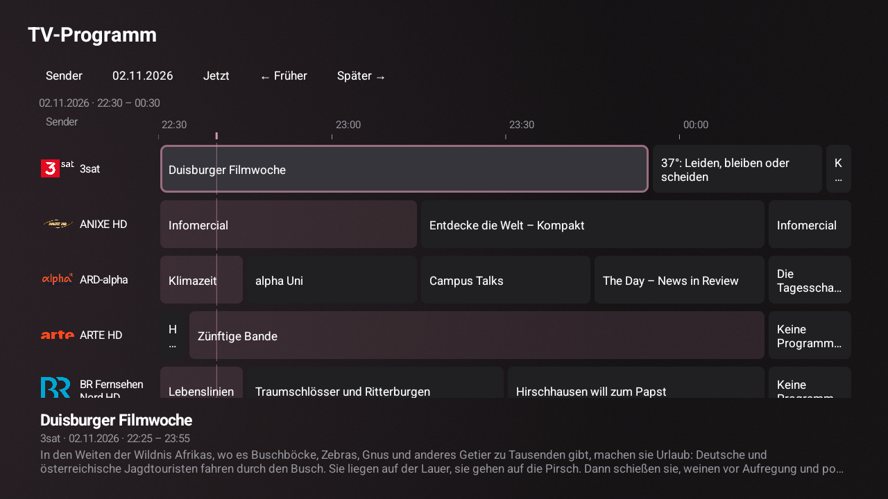

# Lowfin

## **100 % KI-GENERIERT**

> **Persönlich getestet:** Ich habe Lowfin und Lowfin Companion selbst ausgiebig getestet. **Offizielle Releases erscheinen erst nach meinen eigenen manuellen Tests.**

Nativer Jellyfin-Client für schwache **Android-TV-, Google-TV- und Fire-TV-Geräte**. Lowfin verbindet eine für die Fernbedienung ausgelegte Oberfläche mit lokalem Bibliothekscache und nativem Player. Unterstützt Android ab Version 8 sowie HD- und 4K-Oberflächen. Die App ist vollständig auf Englisch (Standard) und Deutsch verfügbar.

[Aktuellen Release herunterladen](https://github.com/303inmyheart/Lowfin/releases/latest) · [Changelog](CHANGELOG.md) · [English](README.md)

## Optionales Server-Plugin

**[Lowfin Companion](https://github.com/303inmyheart/Lowfin-Companion)** ergänzt individuelle Abschluss-/Fortsetzregeln, inkrementelle Cache-Updates, Cover-Tags und zentral verwaltete Bewertungsanbieter-/Tracearr-Verbindungen. Lowfin erkennt das Plugin automatisch und zeigt die verfügbaren Einstellungen an. **Lowfin funktioniert auch ohne Companion.**

## Wichtigste Funktionen

- **Filme und Serien:** Bibliotheken, globale Suche, umfangreiche Staffelsammlungen, Schauspielerseiten, Favoriten, Später ansehen und Gesehen/Ungesehen. Anmeldung mit Jellyfin-Benutzername und Passwort, danach automatische Anmeldung mit dem letzten Konto.
- **Anpassbare Startseite:** Weiterschauen, Als Nächstes, Weil du gesehen hast, Genre-Reihen und Zuletzt hinzugefügt pro Bibliothek. Optionales Entdeckungsbanner und Bibliothekszeile; Sichtbarkeit und Reihenfolge sind einstellbar.
- **Details und Bewertungen:** Bilder, Beschreibung, Genres, Laufzeit, Auflösung/Dateigröße und optionale Bewertungen von OMDb, MDBList und TMDB. API-Keys lokal eingeben/importieren oder die Freigabe über Companion nutzen.
- **Native Wiedergabe:** Tonspur-/Untertitelauswahl, 5.1-auf-Stereo-Downmix, einstellbare Puffer/Videocache, Intro-/Outro-Skip über Jellyfin-Mediensegmente und nativer Trailer-Player. Unterstützte Formate hängen vom Gerät und den Medien ab.
- **Live TV:** Senderliste, Programminformationen und TV-Programmübersicht. Ohne Live-TV-Angebot des Servers wird der Bereich ausgeblendet.
- **Persistenter Bibliothekscache:** optionales Vorladen von Metadaten und Bildern. Mit Companion erhält ein fertiger Cache gezielte Änderungen statt wiederholter vollständiger Scans.
- **TV-Integration:** optionale Android-TV-Startbildschirmzeilen für Wiedergabefortschritt und Empfehlungen; die Verfügbarkeit hängt vom Launcher ab.
- **Anpassbare Darstellung:** dezente Akzentfarben, optionale Animationen, bibliotheksbasierter Bildschirmschoner und fernbedienbare Einstellungen.

## Installation und Updates

1. Die Release-APK unter [GitHub Releases](https://github.com/303inmyheart/Lowfin/releases/latest) herunterladen.
2. Auf den Fernseher kopieren und mit einem Dateimanager installieren. Falls Android danach fragt, die Installation aus dieser Quelle erlauben.
3. Lowfin öffnen und Jellyfin-Serveradresse sowie Konto eingeben. Beim ersten Einrichten auswählen, ob die Bibliothek vorgeladen werden soll.

Unter **Einstellungen → App-Updates** sind tägliche oder manuelle Prüfungen und der Release-Changelog verfügbar. Lowfin benachrichtigt zunächst; Download und Installation startest du selbst. Updates behalten die App-Daten und benötigen dieselbe Signatur.

## Screenshots

Auf einem Android-TV-Gerät aufgenommen. Die Beispiele zeigen die deutsche Oberfläche; Englisch ist ebenfalls verfügbar.

| Startseite | Bibliothek |
|---|---|
|  |  |

| Detailansicht | Einstellungen |
|---|---|
|  |  |

| Empfehlungen | Genres |
|---|---|
|  |  |

## Weitere Informationen

- [Einrichtung, API-Key-Import, Tracearr und selbst bauen (Englisch)](docs/setup-and-development.md)
- [In-App-Updater](docs/app-updater.md) · [Diagnose](docs/diagnostics.md)
- [Companion-Anbindung und technische Grenzen](docs/lowfin-companion.md)
- [GitHub-Actions-Builds](https://github.com/303inmyheart/Lowfin/actions/workflows/android.yml)

Lizenz: [GNU GPL v2](LICENSE). Abhängigkeiten und erforderliche Quellcodehinweise stehen in [THIRD_PARTY.md](THIRD_PARTY.md). Dieses Produkt verwendet die TMDB-API und wird von TMDB weder empfohlen noch zertifiziert.
