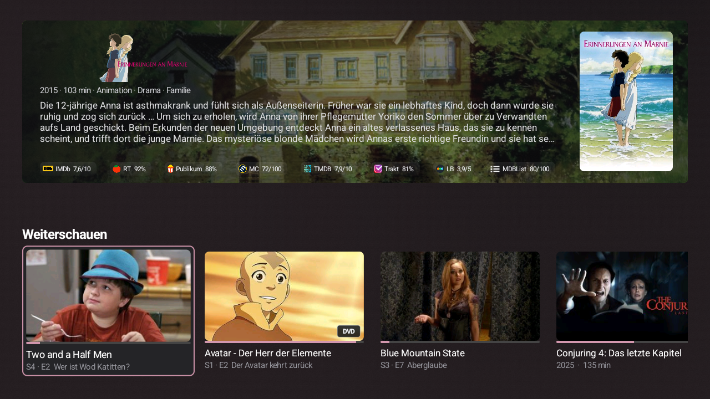
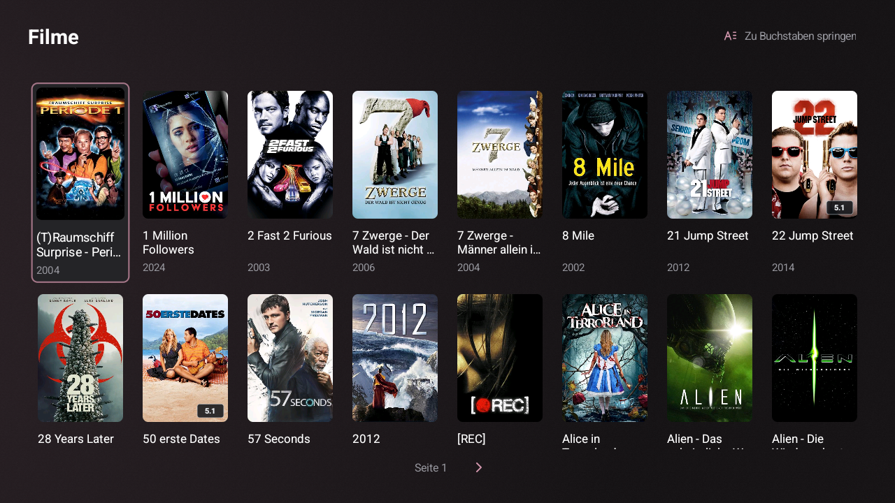
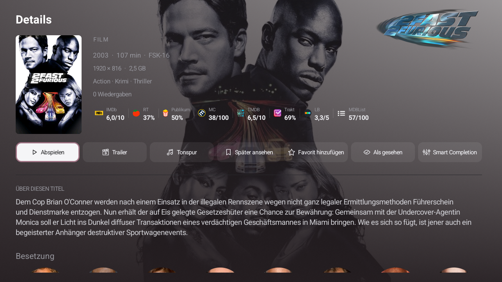
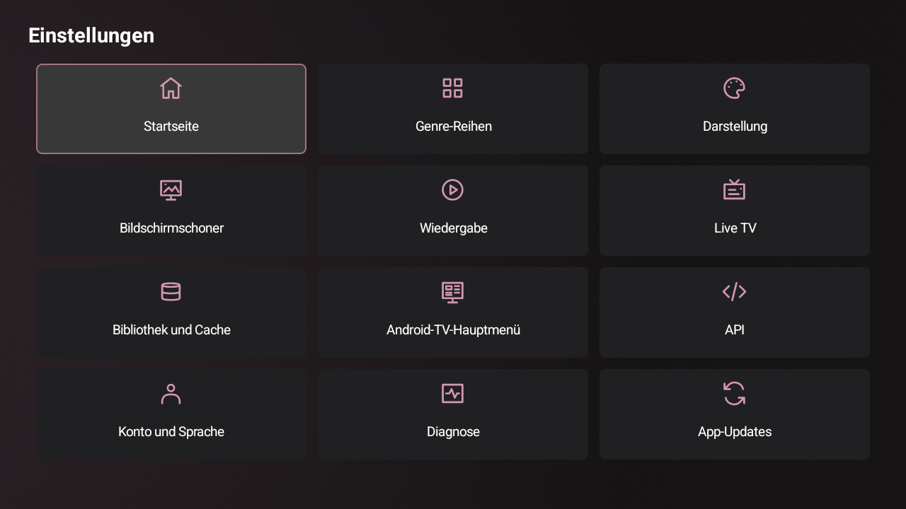
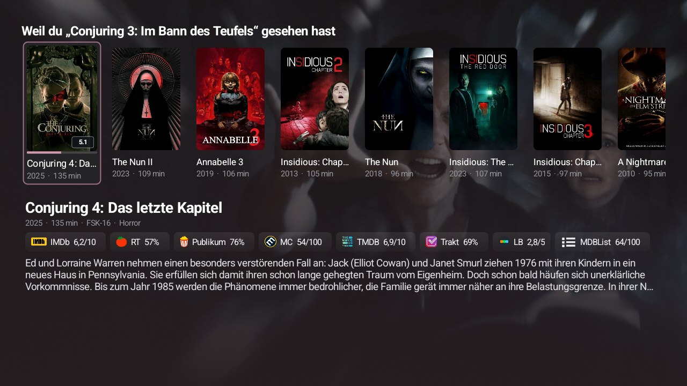
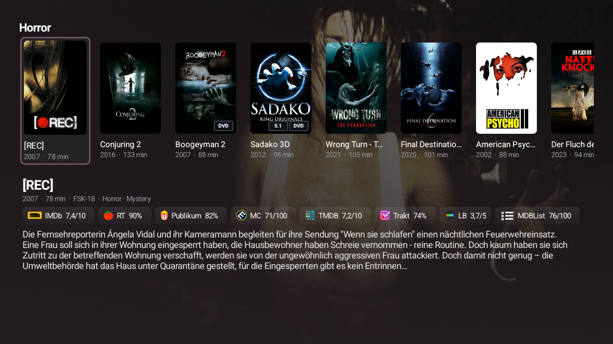
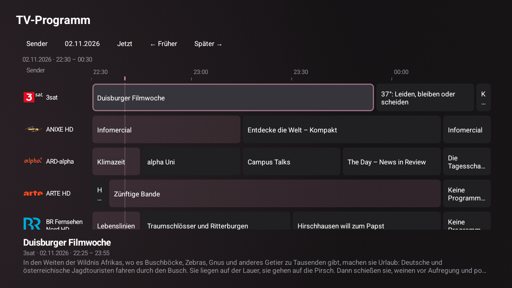

# Lowfin

## **100% AI-GENERATED**

> **Personally tested:** As the project owner, I have extensively tested all features myself.

> **Optional server plugin: [Lowfin Companion](https://github.com/303inmyheart/Lowfin-Companion).** Add per-media Smart Completion/Persistent Resume, incremental library-cache updates, cover tags and centrally managed provider access. Lowfin also works fully without the plugin.

A native Jellyfin client for low-end Android TV devices. Designed for Android 11 and HD displays, with optional 4K playback limits and density-aware artwork; supports Android 8 or later. **Current version: 1.5.2.**

[Deutsche Dokumentation](README.de.md) · [Complete changelog from 0.1.0](CHANGELOG.md)

The optional **Appearance → Pulsing focus outline** switch adds a subtle accent-colored border pulse (off by default; requires UI animations). Banner covers reveal from their center, and the labeled ratings fit the same text column as the description.

## Screenshots

Real 1280 × 720 captures from an Android TV device. These examples show the German interface; Lowfin also includes a complete English interface. Browse with the remote, discover recommendations with ratings, and keep playback controls close at hand.

| Home and discovery banner | Movie library |
|---|---|
|  |  |

| Media details | Settings categories |
|---|---|
|  |  |

### Recommendations and genre shelves

A focused shelf brings together posters, the selected title's backdrop, synopsis and provider ratings.





### Live TV guide

A native programme timeline with channel logos and programme details, opened from the channel list.



## Install

The 1.5.1 signed release APK is built and verified with GitHub Actions, with public diagnostics recording off by default. Download the current APK and its checksum from [GitHub releases](https://github.com/303inmyheart/Lowfin/releases). Transfer the APK to your TV and install it using a file manager with permission to install unknown apps. To update through ADB:

```sh
adb install -r Lowfin-1.5.2-release.apk
```

Sign in with your Jellyfin server URL, username and password. The encrypted session token provides automatic sign-in; passwords are not saved. Server URLs with a subpath are supported.

## Features

Version 1.4 adds a TV programme guide, redesigned settings and sidebar ordering, configurable page sizes, an opt-in update checker, stronger library focus recovery, integrated ratings and a refined home layout. It also reduces redundant layout/text work and batches metadata/EPG operations. English (default) and German are fully available; server metadata keeps its own language.

- Optional native movie-discovery banner under Home settings: backdrop, logo/title, poster, synopsis, runtime, genres and compact rating badges from your selected sources; left/right browse, OK opens details. It is reorderable and off by default.
- Optional animated startup logo without a status caption under Appearance (on by default), waiting for fresh Continue Watching and Next Up and visible artwork; remote dismissal and a 15-second network-failure fallback remain available.

- Optional **Lowfin Companion 0.7.1** for Jellyfin 12.2+: explicitly selected completion/resume rules shared across devices using the same user, scoped episode lists and respected home-library exclusions. Without a selected rule, playback remains native. [Plugin installation](https://github.com/303inmyheart/Lowfin-Companion) · [API and compatibility notes](docs/lowfin-companion.md). Lowfin continues to work without the plugin.

- Lightweight native UI, muted accent palette, optional small animations, compact 2:3 movie/show/season posters and 16:9 episode thumbnails.
- Hold remote **OK/Enter** on home/library cards for Continue, Restart, watched/unwatched, Watch later, favorites and series details. **Watch later** is a persistent device-local list scoped to each account, separate from Jellyfin favorites.
- Optional smooth screen, shelf and drawer transitions, focus scaling and action feedback; disable them under **Settings → Home screen and appearance → Smooth navigation and action animations**, or disable **UI animations** entirely.
- Movies, shows, large season collections, global search, favorites, watched/unwatched controls and movie roulette using real library titles.
- Continue watching, Next up, up to five **Because you watched** movie recommendation rows and individually pinned genre rows. Focused rows can show the selected movie's backdrop, description and ratings.
- Optional 16:9 library shelf on home; independently reorder all home shelves in Settings → Home. Ordering is scoped to the current account and uses stable keys for changing recommendation titles.
- Collapsible remote-controlled sidebar, bounded row navigation, return-to-home behavior and exit confirmation.
- Detail actions use subtle translucent accent surfaces and centered icon/label groups with a clear remote focus. Provider ratings share a borderless treatment across details, the banner and home feature rows; existing display/cache preferences remain.
- Libraries keep the chosen column during rapid vertical navigation. Compact **All series / Started episodes** tabs retain their selected state, and the letter shortcut uses a matching text/icon control. A deliberate Up from the first row reaches the header; Down returns to the originating card.
- **Settings → Library and cache → Items per library page** offers 50–150 library/episode items (default 60). Page-size choices use seekbars: Left/Right moves one unit, holding accelerates gradually, and Save commits the value. Compact accent chevrons replace large paging buttons across list screens.
- **Live TV → TV guide** opens a programme grid with channel logos, a two-hour timeline, day/time selection and programme descriptions. Select a programme for details and **Watch channel** to tune in; Back returns to the channel list. Guide pages contain 25 channels by default; choose 10–50 under **Settings → Live TV**. Channels without current/upcoming EPG data are hidden in the guide by default, with a switch to show them; the regular channel list remains complete. The existing channel long-press guide remains available.
- Live TV opens directly into the channel list. Live-stream negotiation follows Moonfin's opening behavior, with native audio decoding, bounded reconnect handling and subtitles disabled by default.
- Local playback, stereo downmix, configurable disk video cache and adaptive RAM buffers that preserve memory headroom. Optional server transcoding remains disabled by default. Direct playback requires codecs supported by the device or bundled audio decoder.
- Intro Skipper through Jellyfin MediaSegments on Jellyfin 10.10 or later: automatic intro/outro skipping and manual skip controls for other segments.
- Full-screen YouTube trailers in Lowfin’s native Media3 player, with native controls and no YouTube interface. Stream lookup follows the approach used by [Moonfin](https://github.com/Moonfin-Client/Moonfin-Core/blob/main/lib/data/services/youtube_stream_resolver.dart); availability depends on YouTube returning playable media. Trailer quality is capped at 720p for low-end devices.
- Persistent account/server-scoped library metadata and artwork cache. Cached library browsing survives restarts and connection failures. Foreground disk reads/decoding are separate from downloads; preload and UI request matching artwork sizes. Existing 240px HD artwork remains reusable. The artwork budget is bounded: visible uncached covers can replace the least recently used files when it is full, while background preload stops adding files.
- With recognized Companion incremental caching, completed metadata/artwork caches receive only plugin changes; missing/expired cursors retain the cache and show a history-gap notice, with manual refresh available. Empty caches still need an initial build. Without the plugin, automatic preload uses the last successful refresh (24 hours by default). A crash-aware artwork inventory avoids recounting all files on normal starts; stored covers are retained.
- **Ratings and API keys:** without Companion, enter OMDb, MDBList and TMDB keys on the device or import the TXT template; keys are encrypted locally. With Companion, the administrator configures and shares these providers in the Jellyfin plugin dashboard. Client-side provider/rating switches and the optional permanent **on-demand** ratings cache remain available; ratings are never queried during library preloading.
- **Tracearr statistics:** configure the connection locally (including TXT import), or use a connection shared by the Companion administrator. Statistics remain scoped to the signed-in Jellyfin user.
- **Companion cover tags:** server-indexed resolution/audio facts are drawn inside Lowfin card frames. Device settings control their visibility; HDR tags also follow the device HDR playback setting.
- Android TV preview channels for Continue watching, Next up, movies, shows and watched-movie recommendations. Separate movie/show library selection mixes cards across chosen libraries. Launcher support and channel visibility depend on Android TV / Google TV.

- **Recently added by library:** default-on feature rows with descriptions and ratings. Use **Settings → Home screen** for the master switch and individual library switches. Under **Home row order**, press OK to pick up a row, move with Up/Down, press OK to drop, then Save. The list follows the picked row; Back undoes the current move.

## Settings

Version 1.4 presents the twelve settings categories in a three-column grid with accent-colored icons. D-pad navigation stays within each row/column, Left opens the sidebar at the left edge, and Back from a submenu restores its category tile. Home screen is selected on first entry; HD/4K scaling and English/German labels are retained.

Submenus use category context beside compact grouped controls. Under **Appearance → Sidebar layout**, arrange menu entries separately from libraries: menu order is local to the account/device, while library order is saved to the Jellyfin user profile and followed by clients when they refresh it. Press OK on a row, move it with Up/Down, press OK to finish, then Save. Cancel discards the draft; a conflicting server order requires reload/review. [Details](docs/settings-submenus-and-sidebar-1.3.md).

Version 1.4 includes **Settings → Diagnostics** for bounded in-memory performance recording and a private ADB interface. Local builds default to on; public release builds default to off. See [diagnostic commands, data and build options](docs/diagnostics.md).

Version 1.4 also adds **Settings → App updates**: optional daily GitHub checks and notifications, a manual check and readable release changelog. Downloads and installation start only when you select their buttons. Android may require permission/confirmation. See [updater behavior and local release packaging](docs/app-updater.md).

English is the default language regardless of the device language. Select **Language → Deutsch** to use German; the language picker is also available before sign-in. UI, dialogs, player, trailer messages and TV channel names are translated. Library titles, genres and descriptions retain the server's language.

- **Genre rows:** individual account-scoped genre checkboxes, global visibility and the single-focused-row view.
- **Home screen and appearance:** Continue watching and Next up visibility, 0–5 recommendation rows, poster columns, roulette duration, random/fixed muted accent colors, foreground-time color interval, automatic preloading and cache refresh interval.
- **Advanced playback:** individual intro/outro skipping, default subtitles, preferred audio language, seek interval, controls timeout and separate VOD/live RAM buffer ceilings. Buffers always remain adaptive to available memory.
- Existing controls include playback resolution/bitrate, stereo downmix, optional transcoding, disk cache size, artwork budget, rating sources/API keys, Android TV channels and their library sources.

## Import rating API keys

**With Lowfin Companion:** configure OMDb, MDBList, TMDB and Tracearr in the Jellyfin plugin dashboard and share access with all or selected Jellyfin users. For shared providers, local key-entry/import and Tracearr connection controls are hidden; each TV still chooses which providers and ratings to show and whether to cache ratings. The following TXT instructions apply to locally configured connections when server-managed access is unavailable. The Companion manages credentials centrally; it does not read the Android Download TXT file.

When no rating API keys are saved, Lowfin creates **Download/Lowfin-API-Keys.txt** on launch. Fill the provider fields, save as UTF-8 and return to Lowfin. The app checks the file every five seconds while open, encrypts the supplied keys and deletes the file after successful storage. Leave unused providers empty. Existing keys disable automatic import; individual keys remain editable in rating settings. A TXT picker is available if your editor replaces the original Download entry.

```ini
OMDB_API_KEY=
MDBLIST_API_KEY=
TMDB_API_KEY=
TRACEARR_URL=
TRACEARR_API_KEY=
TRACEARR_SERVER_ID=
```

Use the raw key/token after `=` without quotes or a `Bearer` prefix. The generated file explains each provider.

## Build and verify

With JDK 17 and Android SDK platform/build-tools 35 installed, set your local SDK path and use the Gradle wrapper:

```sh
./gradlew testDebugUnitTest lintDebug lintRelease assembleRelease
```

On Linux, `bash tools/bootstrap.sh` installs project-local build tools under `.tools/`; then `bash tools/build.sh testDebugUnitTest lintDebug lintRelease assembleRelease` runs the same checks. Bootstrapping accepts Android SDK licenses. Tools, SDK paths, build directories and private signing keys are excluded from Git.

The `release` APK uses R8/resource shrinking and the local Android debug signing configuration. An existing installation can only be updated using the same signing certificate. The supplied APK preserves the certificate used by earlier Lowfin builds.

Automated tests use JUnit, Robolectric on Android 9 and Android 11, mock HTTP servers and a fake Android TV provider. The release includes [BUILD.json](https://github.com/303inmyheart/Lowfin/releases/download/1.5.1/BUILD.json) with its test count, APK checksum and certificate; historical CI logs were retired during privacy cleanup, and source identifiers refer to the sanitized history. Real device captures are shown above; synthetic UI renderings are produced under `app/build/qa/` during tests. Physical TV/live-server behavior is not validated by these simulated tests.

## GitHub builds

[Android build](https://github.com/303inmyheart/Lowfin/actions/workflows/android.yml) is manual-only (`workflow_dispatch`). Source pushes do not start a build or consume build minutes. When explicitly started, it checks tests and lint, builds a signed release APK and publishes `Lowfin-<version>-build-<run>` containing the APK, SHA256SUMS and BUILD.json. Test/lint reports and HD screenshots are uploaded separately. APK artifacts are retained for 30 days; reports for 14 days.

The release workflow uses the encrypted `LOWFIN_SIGNING_KEYSTORE` Actions secret for the existing Android debug signing key. The job checks that the APK retains the supplied release's certificate, so it can update an existing installation. The workflow fails if the signing secret is absent, rather than publishing an incompatible APK. Private keys are never committed or included in build artifacts. All actions are pinned to specific upstream commits; the workflow has read-only repository permissions.

## License and dependencies

Lowfin is GNU GPL v2; see [LICENSE](LICENSE) and [THIRD_PARTY.md](THIRD_PARTY.md). The bundled FFmpeg decoder includes corresponding wrapper, FFmpeg and AndroidX Media source archives in `third-party/`, with rebuild instructions. Source packages, APKs and verification reports from previous local releases are retained under `dist/`.

This product uses the TMDB API but is not endorsed or certified by TMDB. OMDb and MDBList are optional external services; their own terms apply.

### Tracearr playback statistics

Settings → API → Tracearr connects to the **Public API v2**. Create a Public API token in Tracearr under Settings → Data & API → API. Enter the root URL (preserving any reverse-proxy subpath) and token, then select the matching Jellyfin server and test the connection. The logged-in Jellyfin user is mapped by external user ID; names are never used as a fallback. Older Tracearr instances without API v2 need an update.

Counts include only stopped resume chains marked `watched` by Tracearr. They follow Tracearr’s configured completion rule, not proof that every scene played. Series completions are the minimum completed-play count across all episodes currently available on Jellyfin, **including specials**. Newly added episodes may reduce this count. Missing account mappings, unavailable history and incomplete pagination are shown as unavailable, never zero. Pre-recording history cannot be reconstructed.

The existing `Download/Lowfin-API-Keys.txt` template now also supports:

```ini
TRACEARR_URL=http://your-tracearr-server:3000
TRACEARR_API_KEY=trr_pub_your_token
TRACEARR_SERVER_ID=
```

The optional server ID is Tracearr’s Jellyfin-server UUID, not Jellyfin’s own server ID. Leave it empty and choose the server in settings. Tracearr credentials imported while logged in belong to that Jellyfin account.

The **Create API key file again** button is available in API settings even with saved credentials. It creates a blank template; it never exports stored keys or overwrites an existing download file. Filled fields in an explicitly requested import replace those values; **empty fields preserve saved keys**. Successful encrypted storage is verified before the file is deleted. Unattended initial file creation remains disabled once credentials exist.

Companion 0.3 manages provider credentials in the Jellyfin plugin dashboard, with all-user or selected-user access. Lowfin retains provider/rating choices and its default-on, optional local rating cache; authorized users no longer need local key/TXT/Tracearr connection controls.

Optional DVD / 5.1 frame overlays require Companion 0.4.0. Enable them in the server plugin dashboard, and hide them per TV under Settings → Appearance. Cached artwork is unchanged; 4:3 episode thumbnails cropped to 16:9 keep both labels visible.

Companion 0.5.0 adds a persistent event-driven tag index with a 24-hour reconciliation task. HDR tags require HDR playback to be enabled on that TV. Episode ratings remain uncached.

## Server companion and language

[Lowfin Companion](https://github.com/303inmyheart/Lowfin-Companion) has its own source repository, changelog, releases and Jellyfin update manifest. Clone it into the ignored local `companion/` directory if running the local server integration tools from this checkout. The client never requires the plugin.

Lowfin defaults to **English**, independently of the Android system language. Switch between English and German under Settings → Account and language. UI text, settings, playback actions and import templates are localized; movie/show titles, genres, descriptions and remote server errors retain the language supplied by your Jellyfin server.

New installations ask after sign-in whether to enable library precaching. Until a choice is made, automatic library preloading waits. Existing installations keep their preference; change it under Settings → Library and cache.
