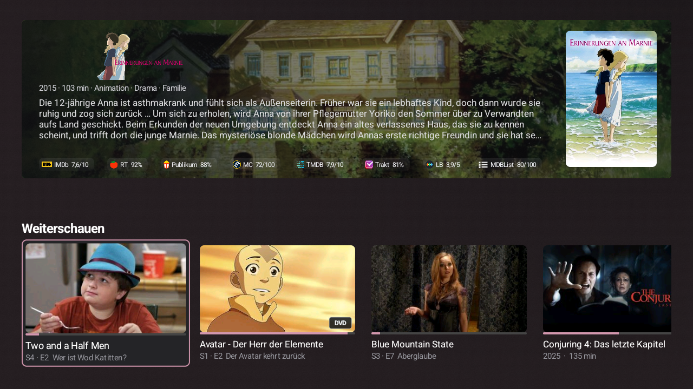
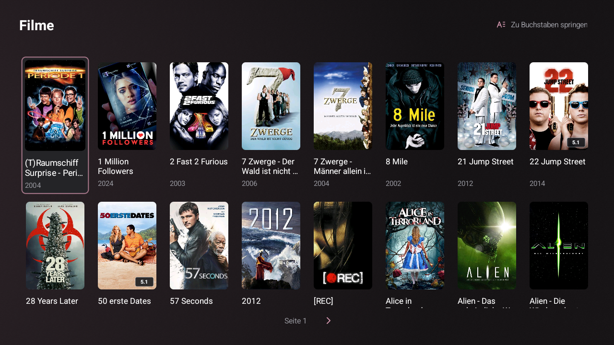
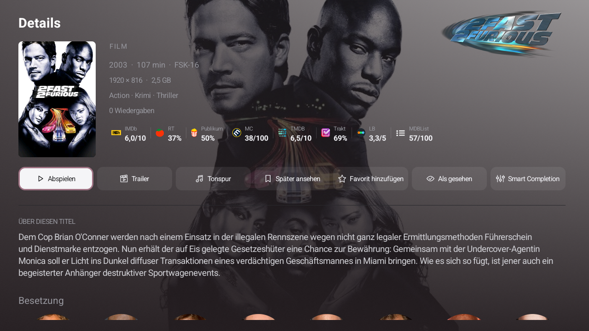
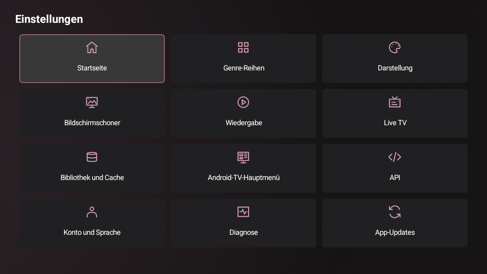
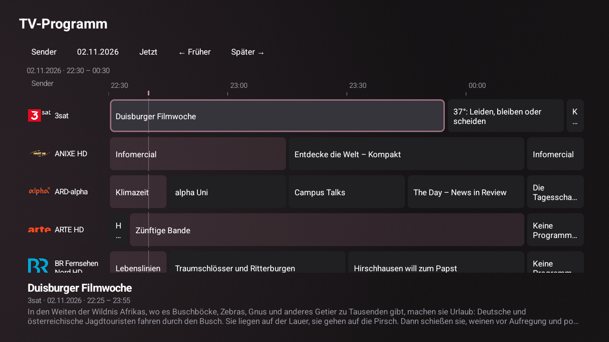
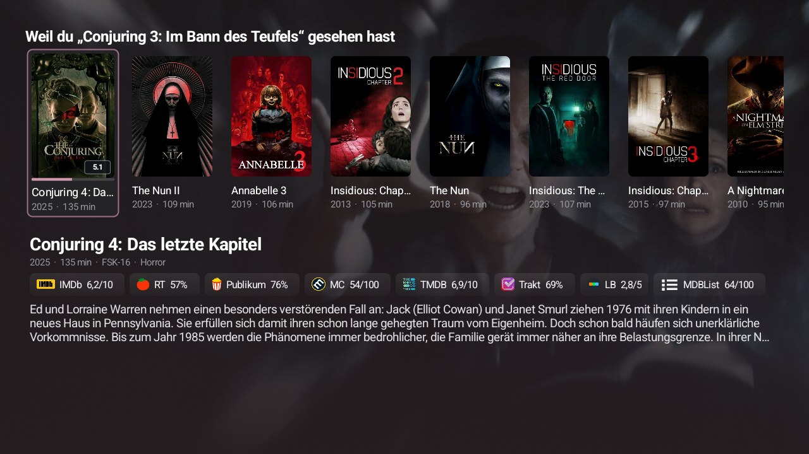
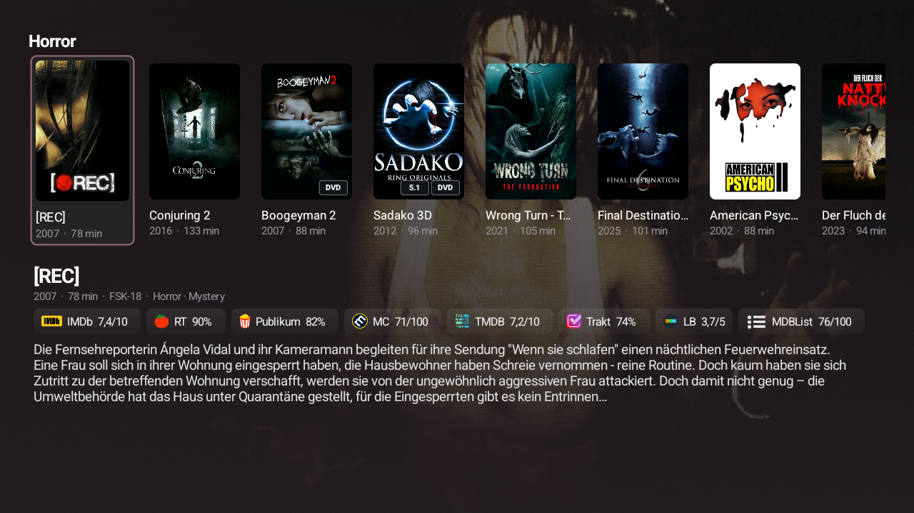

# Lowfin UI showcase

Real, unmodified 1280 × 720 screenshots captured from an Android TV device.
The interface uses German in these examples. No credentials/settings inputs are shown.
Prepared locally for review; these images have not been published to GitHub.

| Home | Library |
|---|---|
|  |  |

| Media details | Settings |
|---|---|
|  |  |

Media artwork, programme information and provider marks shown in the library belong
to their respective rights holders. Screenshots demonstrate the Lowfin interface.

## Home feature shelves

